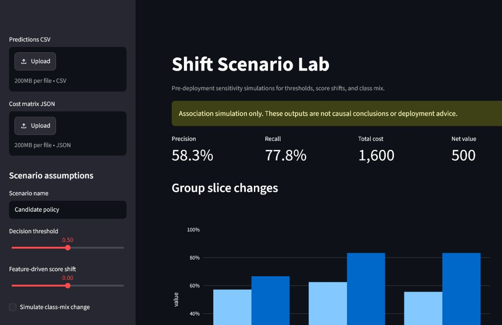

# Shift Scenario Lab

[](https://github.com/KanadeK/shift-scenario-lab/actions/workflows/ci.yml)
[](LICENSE)
[](https://github.com/KanadeK/shift-scenario-lab/releases)

**v0.1.0**. Model teams use Shift Scenario Lab to simulate, before deployment, how
threshold changes, feature-linked score displacement, and class-mix shifts affect
precision, recall, cost, net value, and group slices.



- Local-first CSV and JSON inputs, with no network upload.
- Deterministic business-impact and group-slice calculations.
- Saved scenarios and JSON reports with stated assumptions and an explicit non-causal disclaimer.

```bash
python -m pip install -e '.[dev]'
streamlit run src/shift_scenario_lab/app.py
```

## Quick start

The dashboard starts with the committed synthetic credit sample. To generate a real,
repeatable report without a browser:

```bash
make demo
# Wrote examples/demo-report.json with net value 500.00
```

Use a CSV with `prediction`, `actual`, and `group` columns, plus a JSON cost matrix:

```csv
prediction,actual,group
0.91,1,urban
0.42,0,rural
```

```json
{"true_positive_value": 150, "false_positive_cost": 80, "false_negative_cost": 200}
```

## What it does

1. Imports model scores, binary outcomes, group slices, and a business cost matrix.
2. Recalculates the weighted confusion matrix when the threshold changes.
3. Applies an additive score-shift sensitivity assumption and optional target-prevalence
   reweighting, then compares precision, recall, cost, value, and slices.
4. Saves named scenarios in the current browser session and downloads a report containing
   inputs, assumptions, results, and a disclaimer.

## What it does not do

This tool does not infer causal effects, retrain a model, monitor a live production
service, or decide whether a policy is fair or safe. A score shift is a sensitivity
assumption and class-mix simulation reweights observed labels; neither creates a causal
counterfactual.

## Architecture

The pure `domain` layer is shared by Streamlit and the CLI. `adapters` validate local
files, while `services` handles saved results and report export. Details: [architecture](docs/ARCHITECTURE.md).

## CLI

```bash
python -m shift_scenario_lab.cli demo --output examples/demo-report.json
python -m shift_scenario_lab.cli run --input predictions.csv --costs costs.json --output report.json --threshold 0.65 --score-shift 0.05
```

## Data, privacy, and security

The bundled credit data is synthetic, deterministic, and MIT-licensed with the project.
Imported data stays in the local process. Strip direct identifiers before use. See
[privacy and security](docs/PRIVACY_AND_SECURITY.md) and [security reporting](SECURITY.md).

## Quality and releases

```bash
make verify
make demo
make package
make release-check
```

`make verify` runs Ruff, mypy, 80%-minimum coverage tests, and package build. The release
script creates wheel, sdist, sample report, sample data, and SHA256 checksums in
`dist-release/`, then imports the wheel from a clean temporary directory.

## Why this project

Public-repository sampling found no active project with the same narrow, pre-deployment,
cost-sensitive scenario workflow. Adjacent tools focus on detection, monitoring, model
validation, or online learning; see [the competitor scan](docs/COMPETITOR_SCAN.md).

## Contributing and roadmap

Read [CONTRIBUTING.md](CONTRIBUTING.md) and use synthetic or sanitized data in issues.
Next: richer distribution transforms, scenario persistence, and calibrated uncertainty bands.

## FAQ

**Are results causal?** No. They are deterministic sensitivity calculations under the
displayed assumptions.

**Can I use a real cost matrix?** Yes. Upload a JSON object using the keys shown above.

