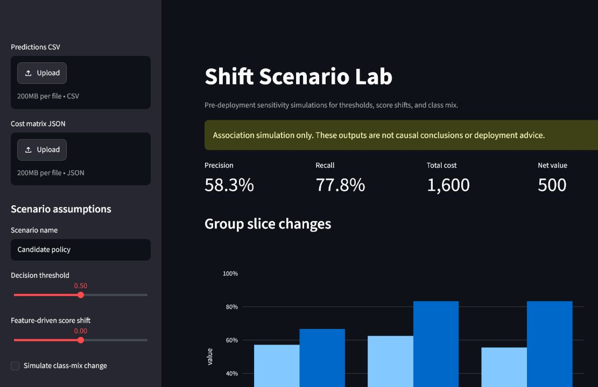

# Shift Scenario Lab

Shift Scenario Lab 是一个本地运行的部署前敏感性模拟器。它用真实的预测分数、二元标签、群体切片和业务成本矩阵，计算阈值、分数位移假设及类别比例变化对 precision、recall、成本和净收益的影响。



## 快速开始

```bash
python -m pip install -e '.[dev]'
streamlit run src/shift_scenario_lab/app.py
```

页面默认加载仓库内合成信贷样例。也可生成可复现的离线报告：

```bash
make demo
```

## 功能

- 导入含 `prediction`、`actual`、`group` 的 CSV 与成本矩阵 JSON。
- 调整决策阈值，真实重算混淆矩阵、precision、recall、成本、净收益和群体切片。
- 使用加性分数位移表达特征分布变化的敏感性假设，使用标签重加权表达类别比例变化。
- 在当前浏览器会话保存多个命名场景并比较，下载包含输入、假设、结果和免责声明的 JSON 报告。

## 边界

工具不进行因果推断、模型训练、线上监控或自动部署决策。分数位移和类别比例都是明确展示的模拟假设，不等价于真实世界因果结论。

## 质量与隐私

数据仅在本地进程处理；提交的样例为可再分发的合成数据。执行 `make verify` 可运行 lint、类型检查、覆盖率测试与构建。更多信息见 [架构](docs/ARCHITECTURE.md)、[隐私与安全](docs/PRIVACY_AND_SECURITY.md) 和 [竞品扫描](docs/COMPETITOR_SCAN.md)。

